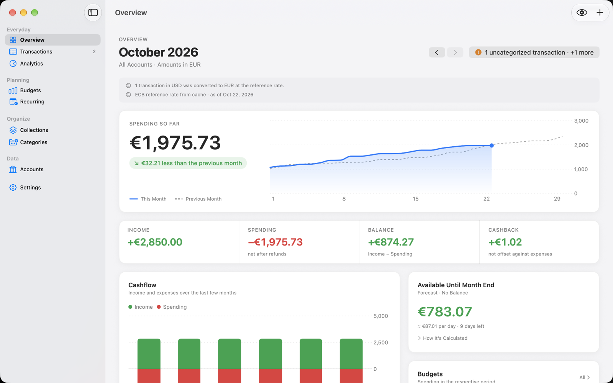
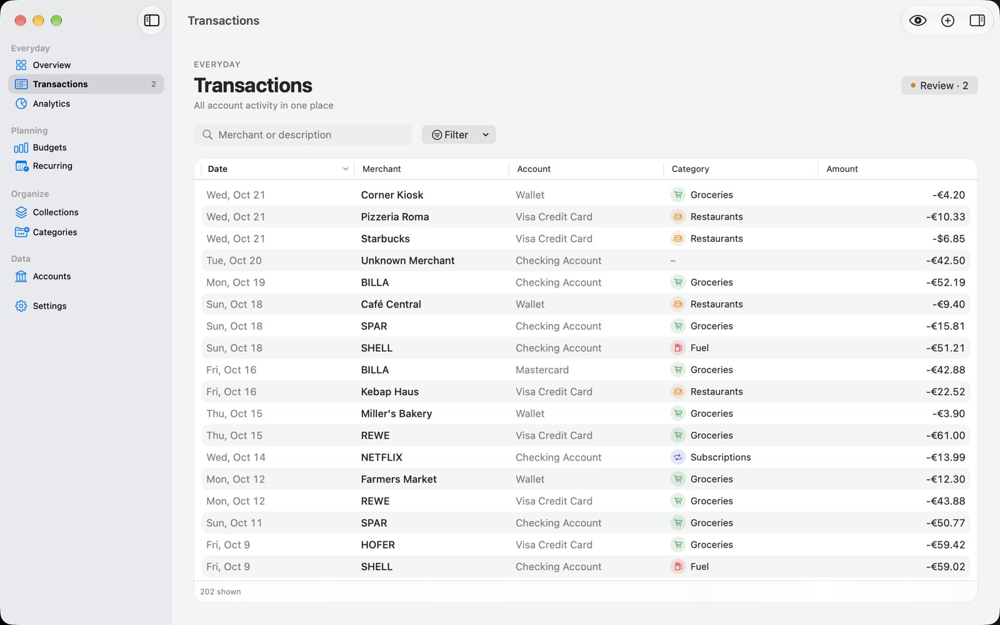
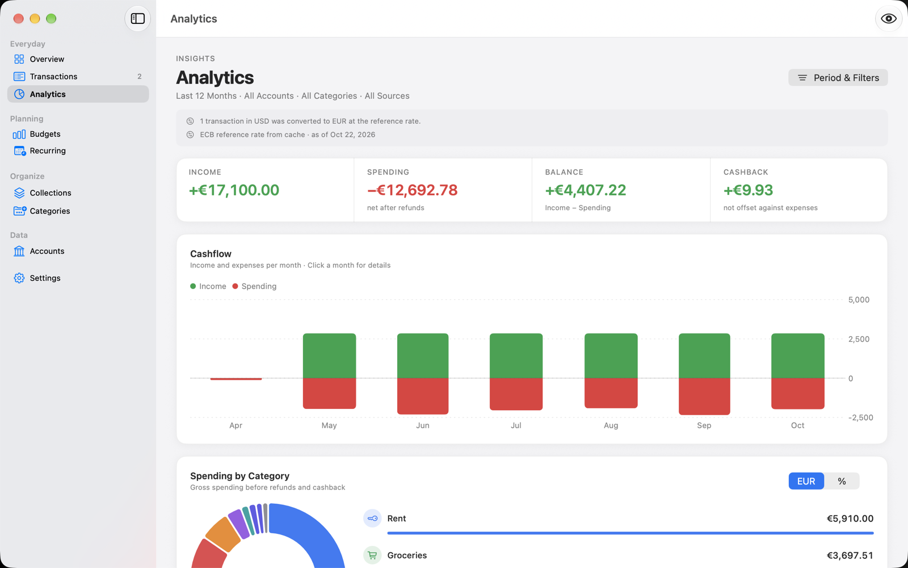
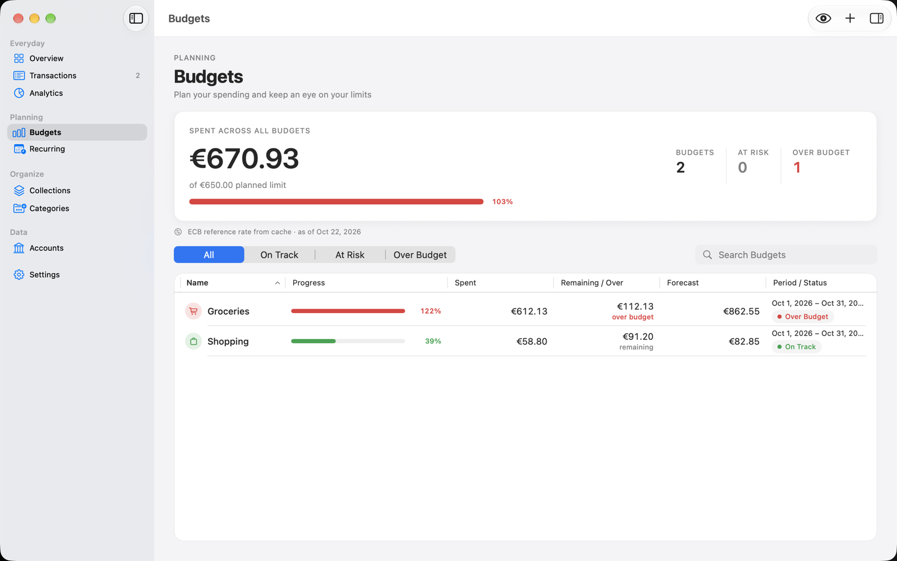
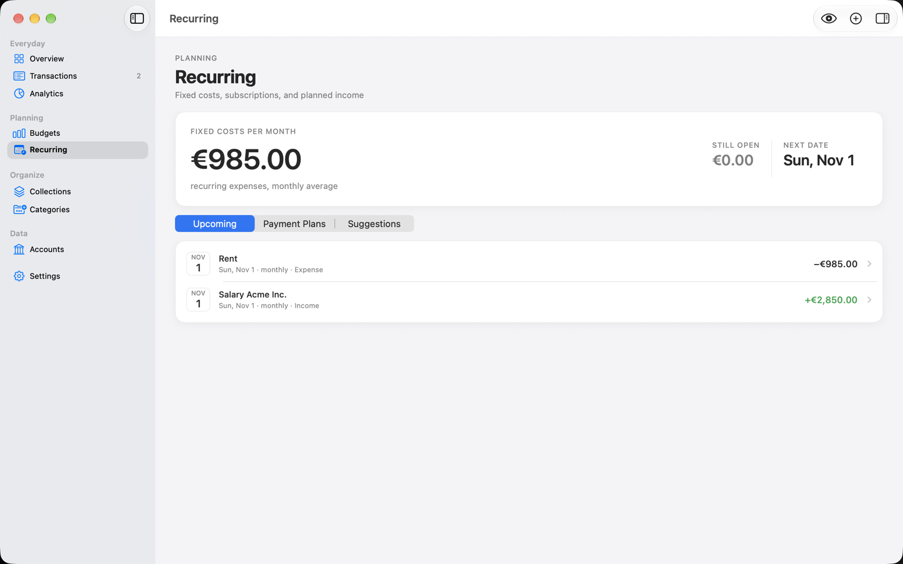

# FinanceTracker

A private, read-only personal finance app for macOS. Your bank data stays on
your Mac: there is no server, no account and no tracking.

<picture>
  <source media="(prefers-color-scheme: dark)" srcset="Screenshots/overview-dark.png">
  
</picture>

The app is available in English and German and follows your Mac's language.
Screenshots show made-up demo data.

## Features

- **Bank sync via Enable Banking** (PSD2, read-only) for thousands of European
  banks, using your own free Enable Banking application. The app cannot make
  payments.
- **File import** for banks and cards that aren't available via bank sync:
  load their CSV, Excel or PDF export. Columns and transaction types (card
  purchases, top-ups, refunds, cashback, fees, interest) are recognised in
  English and German without bank-specific setup; unknown types are asked
  once and remembered. Transactions already in the account from another
  file or from bank sync are not imported twice, and every unreadable row is
  reported instead of silently dropped.
- **Automatic categories** from merchant rules, a built-in merchant list and,
  if available on your Mac, Apple's on-device model. Your own rules always win.
- **Overview and analysis**: monthly spending, cashflow, categories and top
  merchants. Multiple currencies are kept separate unless converted.
- **Budgets, recurring payments and collections** (trips, projects, shared
  expenses).
- **Backups** as a single `.ftbackup` file, plus CSV export.
- Automatic updates via Sparkle.

## Screenshots

| Transactions | Analytics |
|---|---|
| <picture>  <source media="(prefers-color-scheme: dark)" srcset="Screenshots/transactions-dark.png">  </picture> | <picture>  <source media="(prefers-color-scheme: dark)" srcset="Screenshots/analytics-dark.png">  </picture> |
| **Budgets** | **Recurring** |
| <picture>  <source media="(prefers-color-scheme: dark)" srcset="Screenshots/budgets-dark.png">  </picture> | <picture>  <source media="(prefers-color-scheme: dark)" srcset="Screenshots/recurring-dark.png">  </picture> |

## Install

1. Download the latest `FinanceTracker-x.y.z.zip` from
   [Releases](https://github.com/Klabautter/FinanceTracker/releases) and move
   the app to *Applications*.
2. The app is signed with a self-signed certificate, not with an Apple
   Developer ID. On first launch macOS will refuse to open it: right-click the
   app and choose *Open*, or allow it under *System Settings → Privacy &
   Security*.
3. Updates are offered inside the app afterwards.

Requires macOS 15 or later.

## Connecting a bank

The app guides you through it under *Accounts → Add Data Source → Connect Bank
Account*: create a free application in the
[Enable Banking control panel](https://enablebanking.com/cp/applications),
link your own accounts there, then load the downloaded key file into the app.
The key is stored in your macOS keychain only.

## Building from source

```bash
brew install xcodegen
xcodegen generate
xcodebuild -project FinanceTracker.xcodeproj -scheme FinanceTracker -destination 'platform=macOS' build
```

Tests:

```bash
xcodebuild test -project FinanceTracker.xcodeproj -scheme FinanceTracker -destination 'platform=macOS' -skip-testing:FinanceTrackerUITests_macOS
```

The README screenshots come from a debug-only launch mode that fills a
separate, temporary database with made-up demo data:

```bash
xcodebuild test -project FinanceTracker.xcodeproj -scheme FinanceTracker-UITests -destination 'platform=macOS' -only-testing:FinanceTrackerUITests_macOS/VisualQAUITests/testCaptureReadmeScreenshots
```

## Privacy and terms

[Privacy policy](PRIVACY.md) · [Terms of use](TERMS.md)

## License

[MIT](LICENSE)
